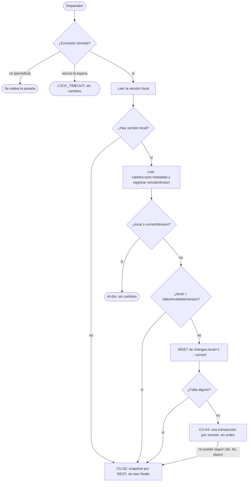

# Sincronización del catálogo e idempotencia

Cómo mantiene este servicio su copia local del catálogo de la cátedra (categorías, profesionales y
horarios semanales) y cómo se recupera de mensajes duplicados, perdidos o fuera de orden. Cubre dos
puntos de la documentación obligatoria del enunciado (§12): la estrategia de sincronización completa e
incremental, y el procesamiento idempotente y la recuperación.

No repite los casos de uso: los resume y los enlaza. El detalle de cada flujo está en
[CU-01](use-cases/CU-01-inicializar-catalogo-al-arrancar.md) (arranque),
[CU-02](use-cases/CU-02-ejecutar-sincronizacion-completa.md) (snapshot),
[CU-03](use-cases/CU-03-incorporar-cambios-del-catalogo.md) (incorporar cambios),
[CU-04](use-cases/CU-04-aplicar-sincronizacion-incremental.md) (incremental),
[CU-08](use-cases/CU-08-disparar-sincronizacion-manual.md) (manual) y
[CU-09](use-cases/CU-09-consultar-estado-de-sincronizacion.md) (estado). Las decisiones (DP-xx) están en el
[README de casos de uso](use-cases/README.md#decisiones-del-proyecto).

## 1. La idea en tres frases

1. **Kafka solo avisa.** Los datos salen de Redis (incremental) o de la API REST (snapshot), y lo que hay
   que aplicar se decide **comparando versiones**: la local contra la que publica Redis.
2. **Una versión es una transacción.** La versión local avanza en la misma transacción que los datos que
   le corresponden, nunca antes ni después.
3. **Repetir no cambia el resultado.** Aplicar dos veces el mismo aviso o la misma versión deja la copia
   igual, así que se puede reintentar sin miedo.

## 2. Los disparadores

Los cuatro corren la misma lógica (CU-03, `IncorporateChangesUseCase`), con su disparador como dato:

| Disparador | Cuándo | `eventId` | Exclusión mutua | Implementado en |
| --- | --- | --- | --- | --- |
| `KAFKA` | Llega un `CatalogUpdated` | Sí: primera barrera y registro | Espera hasta 12 min | `CatalogUpdatedListener` (#31, #33) |
| `STARTUP` | Termina de arrancar el servicio | No | Espera hasta 12 min | `StartupSyncTrigger` (#23, #35) |
| `PERIODIC` | Cada `SYNC_PERIODIC_INTERVAL` (5 min), desde que terminó la anterior | No | **No espera**: si está ocupada, se saltea | `PeriodicSyncTrigger` (#35) |
| `MANUAL` | Un administrador llama a `POST /api/admin/sync` | No | Espera hasta 12 min | `ManualSyncController` (#29, #33) |

La comprobación periódica (DP-04) es la red de seguridad: recupera un aviso perdido, un arranque que no
pudo armar la copia y uno con Redis caído, sin esperar al próximo aviso ni a un reinicio.

## 3. La regla del camino

- La versión objetivo es `currentVersion` de Redis, no el `newVersion` del aviso.
- La condición de ventana es `local < oldestAvailableVersion` (contrato §14.2 y §18.2): con la local en 3
  y `oldest` en 4 es snapshot aunque exista `changes:4`, porque falta la versión que conecta.
- Metadata inválida (falta un campo o no es un número) es un estado no verificable: snapshot (§6.2).

## 4. La versión como unidad de trabajo

| Paso | Transacción | Qué se confirma junto |
| --- | --- | --- |
| Snapshot (CU-02) | Una sola | Las tres colecciones reemplazadas, `snapshotVersion` como versión local y, si lo disparó un aviso, su `eventId` |
| Incremental (CU-04) | Una **por versión** | Las entidades de esa versión, la versión local avanzada en 1 y, en la última del lote, el `eventId` |
| Versión remota (CU-03) | Una corta, después de leer la metadata | `remoteVersion` y, si la copia estaba al día y lo disparó un aviso, el `eventId` |

- **Lo de afuera se lee afuera.** El pedido REST y las lecturas de Redis van fuera de toda transacción
  (los casos de uso son `Propagation.NEVER`), así que las transacciones son cortas y no retienen una
  conexión mientras esperan a la red.
- **Si algo falla a mitad del lote**, las versiones anteriores ya confirmaron y se conservan; la versión
  en curso hace rollback entera. Nunca queda una versión a medio aplicar.
- **Las consultas** (CU-05, CU-06 y CU-07) leen la versión y los datos en `REPEATABLE_READ`: un snapshot
  confirmado en el medio no mezcla la versión vieja con los datos nuevos. No bloquean al snapshot.

## 5. Idempotencia: duplicados, perdidos y fuera de orden

**Dos barreras** (DP-07), para el aviso de Kafka:

1. **El `eventId`.** Si ya está en `processed_event`, el aviso se descarta sin leer Redis y se confirma el
   offset (CU-03, 3a).
2. **La comparación de versiones.** Si `newVersion` es menor o igual a la local, o la local ya alcanza la
   `currentVersion` de Redis, no se aplica nada (7a).

**El `eventId` se registra con los datos**, en la transacción que confirma el resultado, con
`insert ... on conflict do nothing`. Si la transacción hace rollback, el `eventId` tampoco queda, y el
próximo intento lo vuelve a procesar.

**Reaplicar da lo mismo.** Los Hashes de Redis tienen el estado *actual* de cada entidad, no el histórico,
y se guarda con `merge` (crear o actualizar). Volver a aplicar una versión ya aplicada escribe lo mismo; si
la versión local ya es `v`, la versión `v` no se vuelve a aplicar (el "commit dudoso" de CU-04).

| Situación | Qué pasa | Test |
| --- | --- | --- |
| El mismo aviso dos veces | Primera barrera: nada cambia, ni la fecha del último éxito | `SyncEndToEndIT.elMismoAvisoOtraVezNoCambiaNada` |
| Un aviso viejo, fuera de orden | Segunda barrera: nada cambia, el `eventId` queda registrado | `SyncEndToEndIT.unAvisoViejoQueLlegaFueraDeOrden…` |
| Un aviso que se adelanta a Redis | Se llega hasta la versión que publica Redis; la que falta llega con el próximo aviso o la periódica | `IncorporateChangesUseCaseImplTest` |
| Un aviso perdido | La comprobación periódica compara versiones y aplica lo que falta | `SyncEndToEndIT.unAvisoPerdidoLoRecuperaLaComprobacionPeriodica` |
| Varios avisos perdidos con el servicio apagado | El arranque compara versiones y aplica lo que falta | `SyncEndToEndIT.unReinicioConLaCopiaAtrasadaLoRecuperaElArranque` |
| Reaplicar una versión | No cambia nada y cuesta una sentencia menos | `ApplyIncrementalSyncIT.reaplicarUnaVersionNoCambiaNada…` |

La periódica, el arranque y CU-08 no traen `eventId`: su barrera es la comparación de versiones.

## 6. Fallas, reintentos y timeouts (DP-08)

| Dependencia | Timeouts | Reintentos |
| --- | --- | --- |
| API REST de la cátedra (snapshot) | 5 s de conexión y 30 s de respuesta completa | Hasta 3, con 1 s, 2 s y 4 s, solo si la falla es transitoria (timeout, conexión, 408, 429, 5xx) |
| Redis de la cátedra | 5 s de conexión y 3 s por comando | Hasta 3 por tramo: la lectura previa de CU-03, el lote de CU-04 y CU-02 tienen cada uno el suyo, y un reintento repite solo el paso que falló |
| Base de datos propia | 30 s para obtener una conexión (Hikari) | Las fallas transitorias (`DatabaseFailures`) se reintentan igual |
| Lote de CU-04 | 60 s (`sync.incremental.time-budget`) | Después del plazo no empieza otra versión: se conservan las aplicadas y sigue un snapshot |
| Aviso de Kafka con una falla inesperada | — | El `DefaultErrorHandler` lo reintenta con las mismas esperas y después lo da por procesado |

- **Ningún ciclo es ilimitado** (enunciado §8): todo reintento tiene tope y todo tramo tiene cota.
- **El offset de Kafka se confirma después de persistir**, mensaje por mensaje, también cuando la
  sincronización falló: el aviso no trae datos, y lo que faltó se deduce de comparar versiones en la
  próxima pasada.
- **Una credencial rechazada** (401 de la API, `WRONGPASS` o `NOPERM` de Redis) no se reintenta ni
  termina en un snapshot: es un error de configuración, `INVALID_CREDENTIALS`, y la descripción dice cuál
  de los dos fue.

## 7. La exclusión mutua y el peor caso (DP-09)

Una sola sincronización a la vez, con un `ReentrantLock` justo en memoria (una sola instancia del
servicio). El que llega mientras otra corre espera hasta 12 min y, al entrar, vuelve a comparar versiones:
normalmente ya no tiene nada que hacer. La comprobación periódica **no espera**: si la exclusión está
tomada o alguien la espera, saltea la pasada, porque la que corre ya está comparando versiones.

| Cota | Valor | De dónde sale |
| --- | --- | --- |
| Peor caso de CU-03 con la exclusión tomada | 618 s | Versión local, lectura previa con reintentos, el lote de CU-04 hasta su plazo, la versión en curso y CU-02 (tabla en el [README de casos de uso](use-cases/README.md#peor-caso-de-cu-03-con-la-exclusión-tomada-dp-09)) |
| Espera de la exclusión (`sync.lock.wait-timeout`) | 12 min | Cubre un dueño adelante con 102 s de margen |
| `max.poll.interval.ms` de Kafka | 25 min | Una entrega: la barrera, la espera, CU-03 y las esperas del manejador (1375 s) |

`SyncWorstCase` arma la cuenta en los tests con los valores reales: si cambia un timeout, el test lo
nota. El arranque y la periódica corren lo mismo que los demás, así que no cambian la cuenta.

## 8. Qué falla y cómo se recupera

| Falla | Qué queda | Cómo se recupera |
| --- | --- | --- |
| La cátedra no responde al arrancar con la base vacía | Sin copia; las consultas responden `503` con `Retry-After` | La próxima comprobación periódica hace el snapshot |
| Redis no responde | La copia que había; `REDIS_UNAVAILABLE` | La próxima pasada (periódica, aviso o arranque) |
| Falta un `changes:{v}` o la copia quedó fuera de la ventana | — | Snapshot en la misma pasada |
| Una entidad no está en su Hash, o una referencia no existe (CU-04 a mitad de camino) | Las versiones aplicadas antes | Snapshot en la misma pasada, con el mismo aviso |
| La base rechaza una versión | Las versiones anteriores; `INCREMENTAL_FAILED` | La próxima pasada |
| Un aviso ilegible | Nada; `INVALID_EVENT` y el offset confirmado | Si había una versión nueva, la periódica la detecta |
| Un aviso perdido | La copia atrasada | La comprobación periódica |
| El servicio se reinicia con la copia atrasada | La copia atrasada | El arranque (CU-01 con CU-03) |
| El servicio se apaga en medio de una pasada | Las versiones confirmadas; la en curso hace rollback | El arranque siguiente. Spring espera a la pasada hasta 30 s y después la interrumpe |
| Otra sincronización tarda más de 12 min | `LOCK_TIMEOUT` para el que esperaba | La próxima pasada |
| La credencial de la cátedra o de Redis fue rechazada | `INVALID_CREDENTIALS` | Corregir la configuración; no se reintenta |

## 9. Lo que se persiste

Dos tablas de la feature `sync`, creadas por los changelogs de `changelog/sync/`:

**`sync_status`**: una sola fila (`CHECK (id = 1)`), con tres grupos que se completan juntos o quedan
vacíos juntos:

| Grupo | Columnas |
| --- | --- |
| Último éxito | `local_version`, `last_success_at`, `last_success_path` (`SNAPSHOT` o `INCREMENTAL`), `last_success_trigger` |
| Versión remota conocida | `remote_version`, `remote_version_checked_at` |
| Último error | `last_error_at`, `last_error_type`, `last_error_description` |

Se escribe con `@DynamicUpdate` y con la lectura y el guardado en la misma transacción: un error que se
registra mientras otra sincronización confirma una versión no la pisa. "En curso" no se persiste: sale de
la exclusión en memoria.

**`processed_event`**: los avisos procesados, con `event_id` como clave primaria, el `new_version` del
aviso y `processed_at`. No se purga (ver limitaciones).

El modelo de datos completo del servicio va en la documentación de contratos y modelo de datos.

## 10. Cómo verlo

**CU-09** (`GET /api/sync/status`, con un JWT de usuario):

- `localVersion` y `lastSuccess` (fecha, camino y disparador);
- `remote`: la última versión publicada que se leyó y cuándo, sin consultar Redis en cada pedido;
- `inProgress`, de la exclusión en memoria;
- `lastError` con su tipo y una descripción sin datos sensibles, y `resolved`, que es `true` si hay versión
  local y después del error hubo un éxito o una lectura de la metadata (ver CU-09). Sin versión local
  nunca está resuelto: con la base vacía el catálogo no sirve.

**El log**, en INFO: cada sincronización aplicada (`Sincronización (KAFKA): ...`), cada snapshot, y al
arrancar `Comprobación periódica de versión cada 5m`. Los errores en ERROR y cada reintento en WARN. Una
pasada periódica que encuentra la copia al día va en DEBUG, para no llenar el log. Nunca se loguean el JWT
técnico, la contraseña de Redis ni el contenido de los avisos.

**Con la base vacía**, las consultas responden `503` con `code: CATALOG_NOT_INITIALIZED` y
`Retry-After` igual al intervalo de la periódica.

## 11. Limitaciones

- **Una sola instancia del servicio.** La exclusión mutua y "en curso" están en memoria. Con varias
  instancias habría que cambiar el adaptador de `SyncLock` (por ejemplo, un lock de PostgreSQL).
- **Una sentencia colgada en la base no tiene tope** (#29): queda afuera de la cuenta del peor caso.
- **Los `eventId` no se purgan** (DP-07, mejora futura): la tabla crece un registro por aviso, unos 24 por
  día con la cátedra publicando una vez por hora.
- **HS512 con la clave compartida con turnos** (ADR 0003): quien tenga la clave puede firmar tokens.
  No afecta a los datos de la sincronización, que vienen de la cátedra con su propio JWT técnico.
- **La copia puede ir atrasada** hasta un intervalo de la periódica si se pierde un aviso. No habilita
  reservas inválidas: la cátedra valida el slot al crear el hold.

## 12. Las pruebas

Con `./mvnw clean verify` (PostgreSQL, Kafka y Redis con Testcontainers; hace falta Docker):

- **De punta a punta:** `SyncEndToEndIT`, con las evidencias del enunciado (§11) y los flujos de
  recuperación de esta página.
- **Por disparador:** `StartupFullSyncIT`, `StartupIncrementalIT`, `StartupUpToDateIT`,
  `KafkaIncrementalSyncIT`, `KafkaFirstStartIT`, `PeriodicSyncIT` y `ManualSyncNormalModeIT`.
- **Por pieza:** `FullSyncIT` y `FullSyncWithEventIT` (snapshot), `ApplyIncrementalSyncIT` (una
  transacción por versión y reaplicar), `RedisCatalogChangesProviderIT` (Redis con la ACL),
  `SyncStatusConcurrentWritesIT` (`sync_status`) y `ExclusiveSyncIT` (la exclusión), más los unitarios
  de cada caso de uso.
