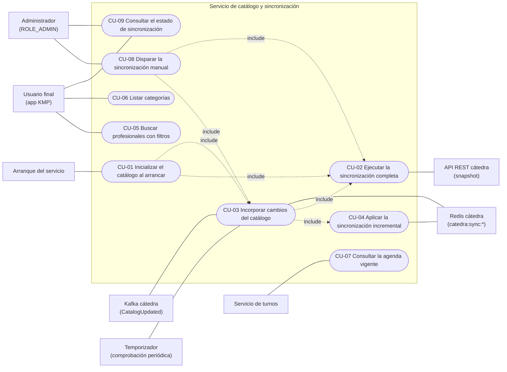

# Casos de uso del servicio de catálogo y sincronización

Casos de uso del servicio de catálogo, escritos antes de implementar. Cada caso indica la sección
del enunciado (`PROJECT_STATEMENT-v1.md`) o del contrato (`INTEGRATION_REFERENCE-v2.md`) que lo
respalda, y las decisiones de diseño que el enunciado deja a cargo del alumno quedan registradas
como **Decisión del proyecto (DP-xx)** en el caso que corresponde.

## Supuesto general

La copia local del catálogo sirve para **mostrar, filtrar y armar la agenda**; la cátedra tiene
la **última palabra al reservar**. La copia puede ir unos segundos atrás de la cátedra (entre que
se publica una versión y se aplica), pero eso no habilita reservas inválidas: al crear el hold, la
cátedra valida profesional, slot y ocupación, y responde `PROFESSIONAL_DISABLED`, `INVALID_SLOT`,
`SLOT_ALREADY_RESERVED` o `SLOT_ALREADY_HELD` si el dato local estaba desactualizado (contrato §9 y
§13.1).

## Actores

| Actor | Tipo | Participa en |
| --- | --- | --- |
| Usuario final (app KMP) | Principal | CU-05, CU-06, CU-09 |
| Administrador (usuario con `ROLE_ADMIN`) | Principal | CU-08, CU-09 |
| Servicio de turnos | Principal | CU-07 |
| Kafka de la cátedra (`CatalogUpdated`) | Principal (disparador) | CU-03 |
| Arranque del servicio | Principal (disparador temporal) | CU-01 |
| Temporizador (comprobación periódica) | Principal (disparador temporal) | CU-03 |
| Redis de la cátedra (`catedra:sync:*`) | Secundario | CU-03, CU-04 |
| API REST de la cátedra (snapshot) | Secundario | CU-02 |

Validar el JWT no es un caso de uso: es una precondición transversal de los casos expuestos por
REST. Este servicio **no** registra ni autentica usuarios; eso vive en el servicio de turnos, que
emite el JWT que el catálogo valida.

## Índice

| CU | Nombre | Actor principal | Objetivo |
| --- | --- | --- | --- |
| [CU-01](CU-01-inicializar-catalogo-al-arrancar.md) | Inicializar el catálogo al arrancar | Arranque del servicio | Dejar la copia utilizable y al día al iniciar |
| [CU-02](CU-02-ejecutar-sincronizacion-completa.md) | Ejecutar la sincronización completa | (incluido) | Reemplazar la copia y guardar `snapshotVersion` en una transacción |
| [CU-03](CU-03-incorporar-cambios-del-catalogo.md) | Incorporar cambios del catálogo | Kafka / Arranque / Temporizador / Administrador | Llevar la copia a la última versión, con deduplicación |
| [CU-04](CU-04-aplicar-sincronizacion-incremental.md) | Aplicar la sincronización incremental | (incluido) | Aplicar versiones en orden, una transacción por versión |
| [CU-05](CU-05-buscar-profesionales.md) | Buscar profesionales con filtros | Usuario final | Filtrar por categoría, nombre, habilitado y disponibilidad sobre la copia local |
| [CU-06](CU-06-listar-categorias.md) | Listar categorías | Usuario final | Ofrecer las categorías para el filtro |
| [CU-07](CU-07-consultar-agenda-vigente.md) | Consultar la agenda vigente de un profesional | Servicio de turnos | Dar las reglas semanales vigentes para armar y validar turnos |
| [CU-08](CU-08-disparar-sincronizacion-manual.md) | Disparar la sincronización manualmente | Administrador | Forzar una sincronización normal o un snapshot |
| [CU-09](CU-09-consultar-estado-de-sincronizacion.md) | Consultar el estado de sincronización | Usuario final / Administrador | Ver versión, última sincronización y último error |

## Diagrama de casos de uso

Mermaid no tiene un diagrama de casos de uso nativo; se representa con un `flowchart`: los
rectángulos son actores, las cápsulas son casos de uso, las líneas continuas son participación y
las punteadas son relaciones `include`.

## Decisiones del proyecto

| DP | Decisión | Casos |
| --- | --- | --- |
| DP-01 | "Disponibilidad" en la búsqueda significa que el profesional atiende en un día o franja según sus horarios semanales habilitados; no considera ocupaciones. Si no se indica el filtro "habilitado", se devuelven solo los habilitados; con `habilitado=false`, los deshabilitados. | CU-05 |
| DP-02 | La app KMP consulta al catálogo directamente con el JWT de usuario emitido por turnos. | CU-05, CU-06, CU-09 |
| DP-03 | Durante una reconstrucción se sirve la última copia confirmada y se informa la versión local; con la base vacía, `503`. | CU-01, CU-02, CU-05, CU-06, CU-07 |
| DP-04 | Comprobación periódica de versión contra Redis cada N minutos (variable de entorno) como disparador adicional de CU-03, con la misma lógica e idempotencia. | CU-01, CU-03 |
| DP-05 | Estado de sincronización: cualquier usuario autenticado. Sincronización manual: solo `ROLE_ADMIN`. | CU-08, CU-09 |
| DP-06 | Turnos usa un JWT técnico de servicio con `aud`/`iss` propio y `ROLE_SERVICE`; `X-User-Login` solo para trazabilidad; los endpoints de usuario rechazan el token técnico. | CU-05 a CU-09 |
| DP-07 | `eventId` procesados en una tabla de PostgreSQL, en la misma transacción que los cambios; la comparación de versiones es una segunda barrera. | CU-03, CU-04 |
| DP-08 | Timeouts configurables, hasta 3 reintentos con backoff de 1 s, 2 s y 4 s; si se agotan, rollback de la versión en curso, se conservan las versiones completas, el `eventId` no se registra, se registra el error y se commitea el offset. | CU-02, CU-03, CU-04 |
| DP-09 | Una sola incorporación de cambios a la vez; los demás disparadores esperan hasta un máximo configurable y, si se supera, terminan sin cambios y lo registran. | CU-01, CU-03, CU-04, CU-08 |
| DP-10 | La sincronización manual corre la lógica de CU-03 por defecto y puede forzar un snapshot con un parámetro explícito. | CU-08 |

## Mejoras futuras

- Purga de `eventId` procesados antiguos (DP-07).

## Decisiones todavía pendientes que afectan a estos casos

- Contrato concreto con el servicio de turnos: rutas, DTOs y códigos de error de CU-07.
- Formato de los changelogs de Liquibase (se decide con la primera migración).
- Cómo se comparte la clave de firma del JWT con turnos.
